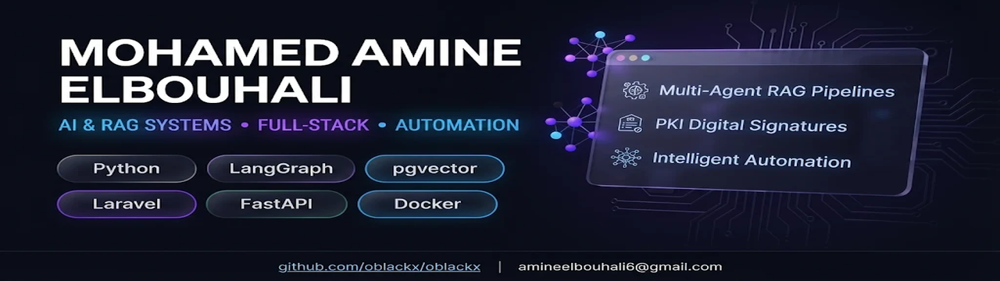
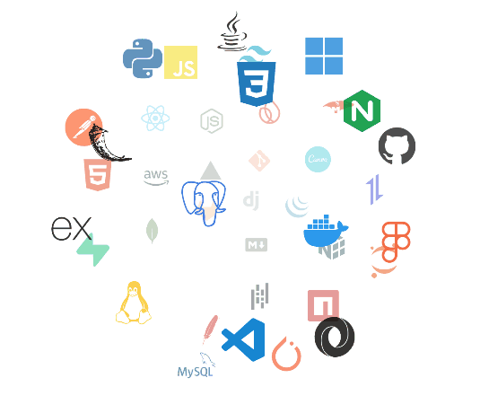

<!--Banner-->

<!--Animated Skills (Dark/Light mode aware)-->
<picture>
  <source media="(prefers-color-scheme: dark)" srcset="./Skills_Animation_Dark.gif">
  <source media="(prefers-color-scheme: light)" srcset="./Skills_Animation_White.gif">
  
</picture>

<!--Header Name-->
#  **Mohammed Amine ELBOUHALI (oblackx)**  
*Computer Engineering Student | Full-Stack & AI/RAG Developer*

---

### 👋 About Me

🔹 **Building** production-grade RAG & multi-agent systems with **LangGraph**, **pgvector**, and **PostgreSQL**  
🔹 **Automating** desktop & web workflows using **Playwright**, **Patchright**, **ScreenHand**, and **Windows Computer Use**  
🔹 **Crafting** open-source CLI tools in **Python** & **Go** for developers  
🔹 **Engineering** full-stack applications with **Laravel**, **FastAPI**, **JavaFX**, and modern tooling  

---

### 🛠 Tech Stack & Latest Updates

<h3 align="left">Current Focus</h3>
<ul align="left">
  <li>Deepening expertise in <strong>Agentic RAG</strong> and <strong>Multi-Agent Orchestration</strong> with LangGraph</li>
  <li>Building cross-platform <strong>desktop automation</strong> pipelines (ScreenHand + Windows Computer Use)</li>
  <li>Developing <strong>AI-powered CLI tools</strong> for codebase analysis and documentation generation</li>
</ul>

<h3 align="left">Tech Stack</h3>

| Category | Technologies |
|----------|--------------|
| **Languages** |       |
| **Frameworks** |      |
| **Data & AI** |     |
| **DevOps & Tools** |      |

 
 
 
 

---

### 🚀 Featured Projects

| Project | Description | Stack |
|---------|-------------|-------|
| **[chatbot-chariaa](https://github.com/oblackx/chatbot-chariaa)** | Multi-agent RAG pipeline with semantic search & hybrid retrieval. LangGraph orchestration for complex conversation flows. | `Python` `LangChain` `LangGraph` `pgvector` `PostgreSQL` |
| **[signature-electronique](https://github.com/oblackx/signature-electronique)** | PKI-based digital signature desktop app. PDF signing, verification & timestamping with certificate validation. Clean JavaFX/FXML architecture. | `Java` `JavaFX` `Cryptography` `PDF` |
| **[signature-electronique-web](https://github.com/oblackx/signature-electronique-web)** | Full-stack web platform for document signing workflows. RBAC, audit trails, document versioning, REST API. | `PHP` `Laravel` `MySQL` `REST API` `RBAC` |
| **[docucraft-ai](https://github.com/oblackx/docucraft-ai)** | AI-powered CLI README generator. Scans codebases, generates professional docs. Local LLM via Ollama for privacy. | `Python` `Ollama` `CLI` `RAG` `LangChain` |

---

### 🏆 Verified Certifications

| Certification | Issuer | Date | Credential |
| :--- | :--- | :--- | :--- |
| **🧠 Neural Networks and Deep Learning** | DeepLearning.AI | Nov 2026 | [View](https://www.coursera.org/account/accomplishments/verify/TCP2HNO5Z5QA) |
| **📊 Foundations: Data, Data, Everywhere** | Google | Nov 2026 | [View](https://www.coursera.org/account/accomplishments/records/UXDSM8IQJGCT) |
| **📋 Foundations of Project Management** | Google | Nov 2026 | [View](https://www.coursera.org/account/accomplishments/records/KXBDE8RPT6DO) |
| **💻 The Unix Workbench** | Johns Hopkins University | Nov 2026 | [View](https://www.coursera.org/account/accomplishments/records/1EAJRHYXDCZ0) |

---

### 📊 GitHub Stats

<table width="100%">
  <tr>
    <td width="50%">
      <h3 align="center"><strong>GitHub Stats</strong></h3>
      

        
      

    </td>
    <td width="50%">
      <h3 align="center"><strong>Streak Stats</strong></h3>
      

        
      

    </td>
  </tr>
  <tr>
    <td width="50%">
      <h3 align="center"><strong>Top Languages</strong></h3>
      

        
      

    </td>
    <td width="50%">
      <h3 align="center"><strong>Contribution Graph</strong></h3>
      

        
      

    </td>
  </tr>
</table>

 

---

### 🌟 Thought of the Day

<!--STARTS_HERE_QUOTE_CARD-->

    

<!--ENDS_HERE_QUOTE_CARD-->

*Last updated: Nov 21, 2026*

---

### 🤝 Connect With Me

  
  

  

  

 

---

### 💬 Ask Me About

- Designing **agentic RAG pipelines** with hybrid retrieval (dense + sparse + reranking)
- Building **multi-agent systems** with LangGraph for complex workflows
- **pgvector/PostgreSQL** optimization: HNSW indexes, BM25, RRF fusion
- **CLI tool development** in Python (Typer, Rich) and Go
- **Desktop/web automation** with Playwright, Patchright, ScreenHand
- **Full-stack development**: Laravel, FastAPI, JavaFX
- **Docker & CI/CD**: GitHub Actions, multi-stage builds, Testcontainers
- **Open-source contribution** and maintainer workflows
- **Collaborative pair-programming workflows** with GitHub PRs and co-authored commits

---

  

  Built with ❤️ by <a href="https://github.com/oblackx">Mohammed Amine ELBOUHALI</a> • Auto-updated daily via GitHub Actions • Last refresh: 2026-11-21

- Collaborative pair-programming workflows with GitHub PRs and co-authored commits
